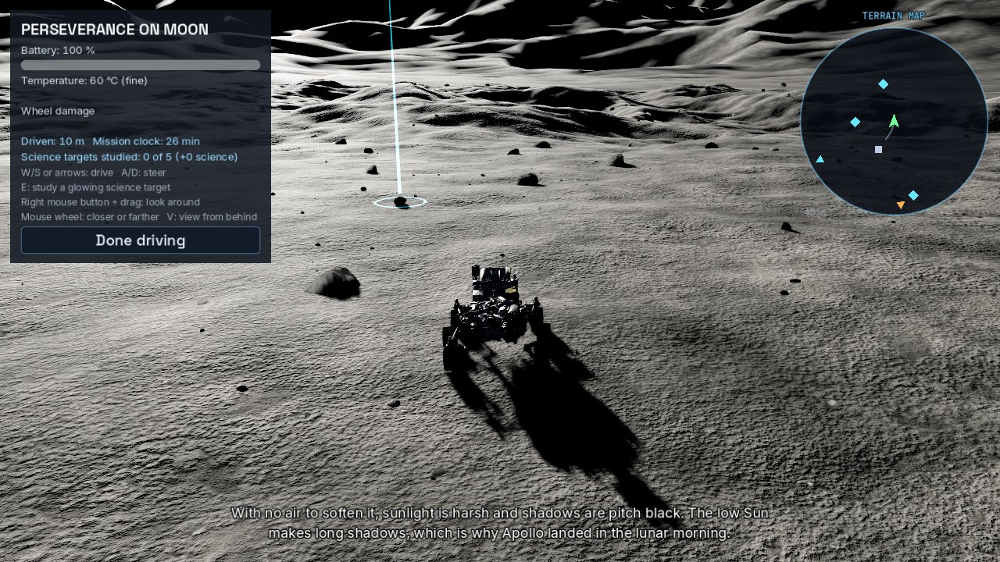
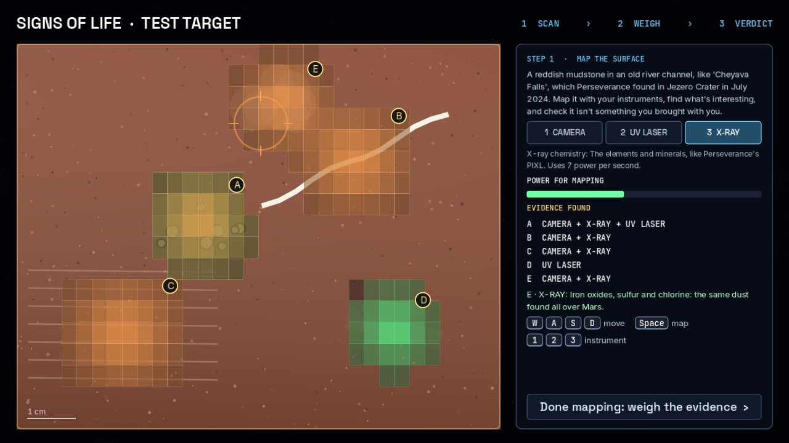
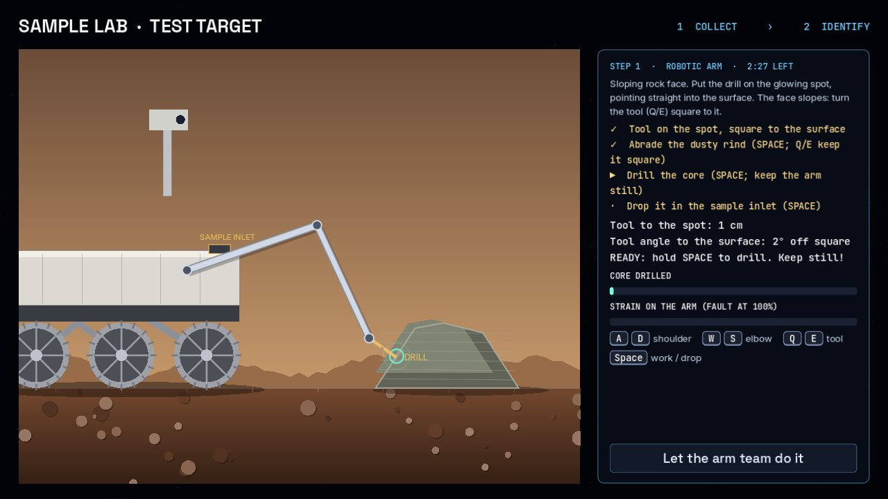
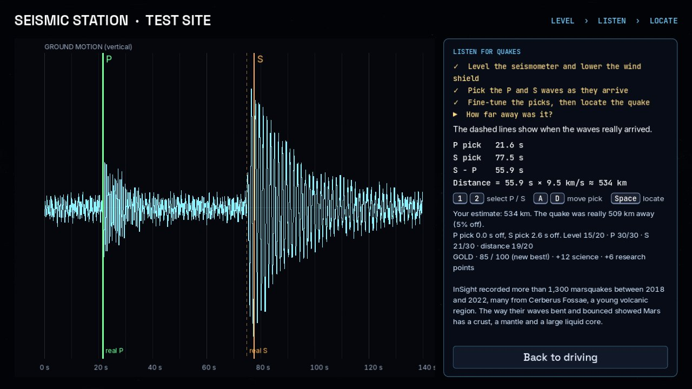
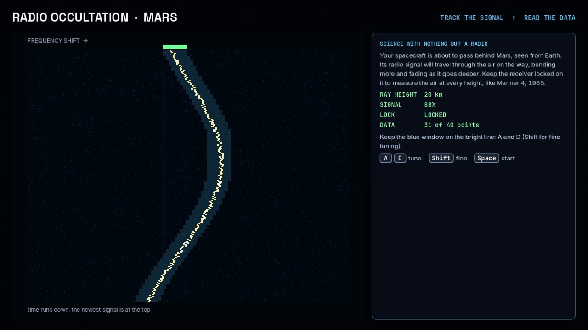

# Orbit Lab

**Design a space mission, launch it, and fly it, with real physics and real NASA science.**

Orbit Lab is Team Astra Vanguard's entry in the 2026 NASA Space Apps Challenge. The challenge was to build an interactive game where players design, manage and simulate a complete space mission with engineering trade-offs. You pick a destination, build a spacecraft from real parts, choose a rocket that can actually lift it, and fly the whole mission. Along the way you make the calls real mission teams make, and play hands-on minigames at every stage.

Built in **Godot 4.7.2**.



## Run it

1. Install [Godot 4.7.2](https://godotengine.org/download) (the standard version; C# isn't needed).
2. Clone this repository and open `project.godot` in Godot.
3. Press **F5** (or the Play button) to start at the main menu.
4. Go to Itch.io and search up the game or paste this website (https://astravanguard.itch.io/orbit-lab) You can then choose to run on the web or download (download is reccomended for better performance-if it shows a "windows protected your computer" just click more info and run anyway) 

To share the game without Godot, use **Project › Export** for Windows, macOS, Linux or Web.

### Web version

The repository includes a **Web** export preset (`export_presets.cfg`) that builds with threads, which keeps sound and loading smoother in a browser. A threaded build needs the page to be "cross-origin isolated": on itch.io, tick **SharedArrayBuffer support** in the embed options. Exports go in the `build/` folder. Open the game from a web server, not by double-clicking `index.html`.

The first time the web version starts, it spends a few seconds "getting the graphics ready" (`scripts/shader_warmup.gd`): it draws the game's materials once in a hidden view so the browser compiles their shaders before the mission, instead of freezing at each new step. The rest carries on quietly in the background on the menu screens. The web version also starts on Medium graphics; players can change this in Settings.

## How a mission goes

| Stage | What you do | What's real about it |
| --- | --- | --- |
| **Pick a destination** | Choose from 24 worlds in the solar system view, from the Moon to Eris. | Distances, travel times, arrival burns and budgets scale with the real solar system. |
| **Design the spacecraft** | Choose power (solar or nuclear), batteries, antenna, shielding, instruments and how you'll arrive: orbiter, lander, rover, heat shield, airbags or sky crane. | Masses, costs, power at each distance from the Sun and data rates follow real spacecraft. Wrong choices fail for real reasons, like solar panels at Saturn or no heat shield at Mars. |
| **Choose a rocket** | Falcon 9, Atlas V, SLS, Saturn V or Starship, or build your own. Optionally plan a gravity assist or test-fire engines. | The rocket equation decides whether your spacecraft makes it. |
| **Launch and cruise** | Watch the launch, then make decisions as events come up: solar flares, software bugs, course corrections. Steer through the asteroid belt. | Events are drawn from real missions. |
| **Arrive** | Do the orbit insertion burn. An orbiter maps the world and photographs famous places; a lander goes down to the surface. | Orbits use Kepler's laws. Landings match the world's air and gravity. |
| **Do the science** | Play the minigames below. | Every sample, reading and answer comes from real mission results. |
| **Results and career** | Get a grade, XP and research points. Spend research on 31 technology upgrades and unlock achievements. | |

Three difficulty levels: **Cadet**, **Standard** and **Veteran**. Progress saves automatically on the player's computer.

## Minigames

None of them can end a mission, and each one has medals, personal bests and research points.

| Minigame | Where it appears | Based on |
| --- | --- | --- |
| Engine test lab | Rocket builder, Training tab | Throttle, mixture ratio, thrust, Isp and chamber heat of real engines |
| Gravity-assist planner | Rocket builder | Patched-conic flyby physics; Cassini and Galileo-style flybys |
| Orbital insertion | Arrival | Braking from a hyperbolic arrival into orbit; real GM, the rocket equation and the Oberth effect |
| Asteroid and Kuiper belt piloting | Cruise | Dodging rocks and collecting science shards |
| Orbit science | Orbiters | Mapping strips and photographing real landmarks; data volume and power in shadow |
| Aerobraking | Orbiters at Mars and Venus | Magellan (1993) and Mars Reconnaissance Orbiter (2006): drag, heating and dust storms |
| Radio science | Orbiters at most worlds | Radio occultations (Mariner 4, Voyager, New Horizons) and gravity mapping (GRAIL, Dawn, Galileo, Juno) |
| Rover traverse | Landers with rovers | Battery, slopes, soft sand and wheel damage |
| Sample lab | Rover science stops | Robotic arm with abrading, drilling, scooping and sieving; identify 42 real materials with your own instruments |
| Signs of Life | Mars, Europa, Enceladus, Titan, Ceres | NASA's Confidence of Life Detection (CoLD) scale and real finds like Cheyava Falls |
| Seismic Station | Mars and the Moon | InSight and the Apollo seismometers: P and S waves |
| Docking and sample return | Sample-return landers, Training tab | Clohessy-Wiltshire relative motion; Chang'e 5's lunar-orbit docking |

| | |
| --- | --- |
|  |  |
|  |  |

The career screen's **Training** tab lets you play the docking trainer, engine lab, Signs of Life, Seismic Station, Aerobraking and Radio Science any time, without a mission.

## Real data, and where it's simplified

- Planet and moon masses, sizes and orbits come from NASA JPL. Mission facts and dates come from NASA, ESA and the published science.
- 3D spacecraft, rover and lander models come from [NASA 3D Resources](https://github.com/nasa/NASA-3D-Resources). Mission audio is NASA's own.
- Where the game simplifies something, the code says so in a comment. Examples: orbits drawn in one plane, a wider mapping swath, sped-up passes, and tuned aerobraking drag. No NASA statistic is made up.
- Nobody has found life beyond Earth, and the Signs of Life minigame never says otherwise.

The full list of models, textures, sounds and fonts, with their licenses, is in [CREDITS.md](CREDITS.md).

## Project layout

```
scenes/     every screen and minigame as a Godot scene (.tscn)
scripts/    the game logic, one script per scene, plus data files (geology_samples.gd, life_signs.gd, radio_science_data.gd...)
shaders/    planets, terrain, atmosphere and effects
assets/     models, textures, sounds, fonts
tools/      Python helpers used to prepare assets
```

## Use of AI

Much of the code and in-game text was written with help from an AI assistant (Anthropic's Claude). The team designed the game, directed the work, play-tested and reviewed it. AI-written facts were checked against NASA and published sources. No images, video or audio were made with generative AI. The art and sound come from the sources in CREDITS.md; a few textures (rocks, landing-site ground, tinted moon maps) are drawn by the Python scripts in `tools/`.

## Team

Team Astra Vanguard, NASA Space Apps Challenge 2026.
